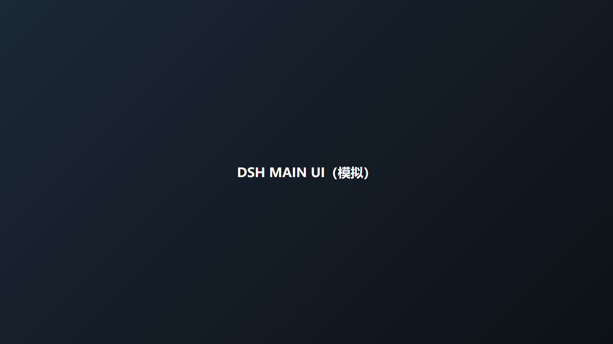
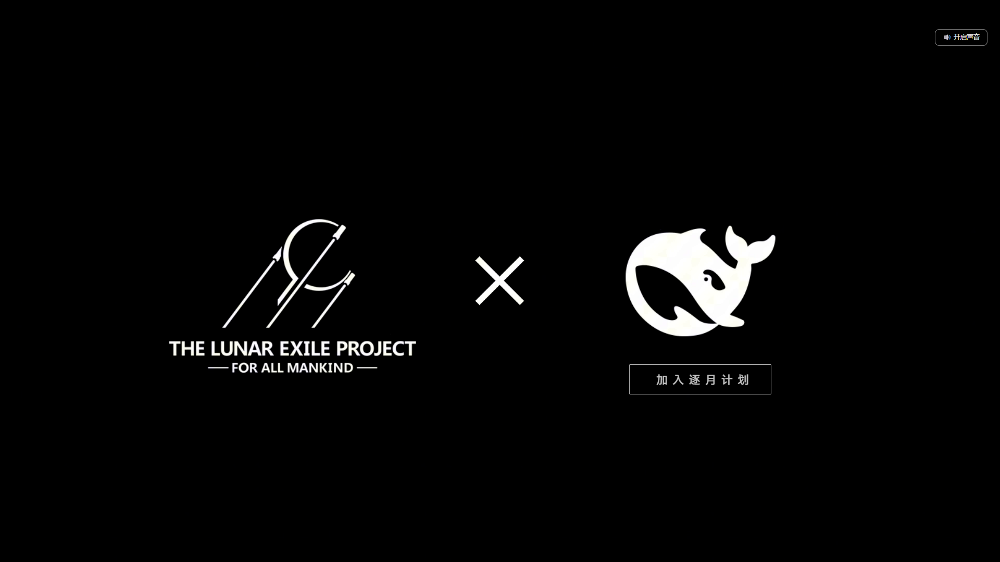

# dsh-lunar-boot · 逐月计划开机动画


DeepSeek Harness（DSH）开机动画插件：启动时全屏播放逐月计划开场影片，**播完定格在尾帧**，鲸鱼图标下方浮出「**加入逐月计划**」按钮，**只有点击按钮才进入** DeepSeek Harness 主界面。

架构与交互参考 [dsh-550c-boot](https://github.com/yannicksong0106/dsh-550c-boot)（550C 开机动画插件）：同样是「宿主半边注入首帧 + 客户端半边 Shadow DOM 遮罩」的两半式 DSH 插件，零运行时依赖。

## 效果演示

影片播完 → 定格在逐月计划 × 鲸鱼联名尾帧 → 图标下方淡出「加入逐月计划」按钮 → 点击后遮罩淡出、进入主界面。

| 定格 + 按钮门禁 | 点击进入主界面 | 视频失败时的静态兜底 |
|:---:|:---:|:---:|
|  |  |  |

- 片头播放期间，窗口右上角的原生最小化 / 最大化 / 关闭按钮浮在动画上（标题条透明化），窗口顶部仍可拖动。
- 每次启动（含刷新页面）都会播放；与 550c 一致，**故意不做**「每会话只播一次」。

## 目录

- [安装](#安装)
  - [桌面客户端（DSH Desktop Beta）](#桌面客户端dsh-desktop-beta)
  - [Web 版 / CLI](#web-版--cli)
- [使用](#使用)
- [常见问题](#常见问题)
- [技术说明](#技术说明)
- [Credits](#credits)

## 安装

### 桌面客户端（DSH Desktop Beta）

桌面 profile 由 Electron 应用独占管理，CLI 的 `dsh plugin --profile desktop` 会被拒绝——这是设计如此。请用**应用内插件管理器**：

1. 打开 DSH 桌面版 → **设置 → 插件**
2. 安装插件，选择本地目录：指向你 clone / 解压出来的 `dsh-lunar-boot/` 文件夹（即本 README 所在的目录）
   - 也可以安装打包好的 `dsh-lunar-boot-1.0.0.tgz`
3. **重启客户端**（bundle 在启动时装配）
4. 重启后开机动画即生效

### Web 版 / CLI

```bash
# 本地目录（在本仓库的上级目录执行）
dsh plugin --profile web add ./dsh-lunar-boot

# 或打包好的 tarball
dsh plugin --profile web add ./dsh-lunar-boot-1.0.0.tgz

# 或从 GitHub Release 直接安装
dsh plugin --profile web add https://github.com/pat-oss/dsh-lunar-boot/archive/refs/tags/v1.0.0.tar.gz
```

装完同样**重启一次** DSH。升级或重装后按 `Ctrl+Shift+R` 硬刷新（DSH 的客户端 bundle 带 `max-age=31536000`，普通 F5 会一直用第一次抓到的副本）。

## 使用

### 设置

**设置 → 通用 → 逐月计划开机动画**：

- **开启 / 关闭**：关闭后启动直接进主界面，一张黑屏都不会出现（宿主半边的首帧注入也会一并退让）
- **预览**：立刻完整放一遍（定格 + 按钮 + 点击进入的完整流程）

### 声音

浏览器可能拦截「带声音的自动播放」。被拦截时动画**静音播放**，画面右上角会出现「🔊 开启声音」开关，点一下即可。桌面端若允许带声自动播放，则直接有声、不出现开关。

### 卸载

设置 → 插件 → 找到 dsh-lunar-boot → 卸载，重启客户端。

## 常见问题

**Q：动画播完了但按钮迟迟不出现？**
影片 12.5 秒，结束后约 0.35 秒按钮淡入。若视频文件加载失败（极少见），会**直接显示定格尾帧 + 按钮**（静态兜底），不会卡黑屏。

**Q：按钮出现了但点不动 / 点不了？**
看门狗 60 秒超时自动放行，任何异常都不会把你锁在主界面外。若遇到，重启客户端即可恢复。

**Q：想换影片 / 换尾帧？**
把新视频放到 `assets/` 并覆盖两个文件，然后重建：

```bash
# 1. 用 ffmpeg 重封装（moov 前置，保证流式起播）
ffmpeg -i 新视频.mp4 -c copy -movflags +faststart assets/lunar-boot.mp4

# 2. 导出最后一帧作为定格帧（N 为总帧数减一）
ffmpeg -i 新视频.mp4 -vf "select='eq(n\,N)'" -vsync 0 -frames:v 1 assets/lunar-lastframe.png

# 3. 重新构建客户端模块
node scripts/build.mjs
```

若尾帧构图变化，按钮落点要同步调整：`src/client.js` 里的 `GATE_LEFT_PCT` / `GATE_TOP_PCT`（按 1920×1080 设计坐标的百分比，当前值对应尾帧鲸鱼图标 bbox x 1201–1488 / y 434–628 的正下方）。

**Q：和 550c 开机动画冲突吗？**
不冲突，可同时安装。两个遮罩都走最高层级，后加载的盖在前面；建议只开一个（各自的设置里切换）。

## 技术说明

### 为什么是「两半式」

DSH 自己的开机卡片（`[data-dsh-boot]`，"HARNESS / Loading plugins…"）由 shell 内核在客户端插件物料化**之前**就画上去了——550c 真机实测：卡片 67ms 出现、客户端 bundle 338ms 才求值完。所以首帧不能靠客户端插件画，必须由**宿主半边**通过 `webserver/index-inject` 事件往 index.html 的 `<head>` 里注入（一条纯黑 style + 一条同步 script），早于 shell 建卡；客户端遮罩挂载的同一任务调用 `window.__lunarBootFirstFrame.end()` 退役它，同帧无缝交接。注入脚本自带开机卡片监看（250ms）和 20s 绝对超时——客户端半边永远不来，也不会留下一个黑窗口。

### 客户端模块格式（硬约束）

客户端入口必须是 `window.__ModuleLoader__.load({ id, factory: (require) => { … return module.exports } })` 形状：

- `require` 是 factory 的参数（页面里没有裸 `require`，直接 `ReferenceError`）
- 所有插件 client 会被拼进同一个 bundle 当 ESM 求值，顶层声明不包进 factory 会互相撞（`const React` 撞车 → 整条 bundle `SyntaxError`）

`scripts/build.mjs` 负责把 `src/client.js` 包成这个形状（零依赖，无打包器）。

### 定格为什么零跳变

视频（16:9）和定格 PNG 都以 **contain** 含纳在同一个 JS 计算的居中外框里（黑边不可见，因为设计稿底色就是纯黑），窗口任意比例下两者像素级重合；播完只需藏掉 video、露出同位置的 img。按钮落点按设计坐标百分比定位在外框内，跟随缩放不漂移。

### 文件结构

```
dsh-lunar-boot/
├── package.json            # DSH 清单：engines / bundle.patch / client.inject / platform
├── cordis.patch.yml        # bundle 补丁：把插件挂进 profile（insert boot-lunar）
├── lib/
│   ├── index.js            # 宿主半边：index-inject 首帧 + /dsh-lunar-boot/* 资产路由（带 Range）
│   └── client.js           # 客户端半边（构建产物）：ModuleLoader 工厂模块
├── src/client.js           # 客户端半边源码：遮罩 / 视频 / 定格 / 按钮门禁 / 设置行
├── scripts/build.mjs       # 构建：src/client.js → lib/client.js
├── assets/
│   ├── lunar-boot.mp4      # 开场影片（faststart，约 11.5MB）
│   └── lunar-lastframe.png # 定格尾帧（1920×1080）
├── docs/                   # README 截图
├── test-host.mjs           # 宿主半边自测（node test-host.mjs）
└── README.md
```

### 本地开发

```bash
node scripts/build.mjs   # src/client.js → lib/client.js
node --check lib/client.js && node --check lib/index.js   # 语法检查
node test-host.mjs       # 宿主半边自测（不依赖 DSH）
```

### 已验证环境

- DSH Desktop Beta **2.0.9-beta.1**（win32 / Electron v24.18.1 / Node v24.18.1）
- 真机验证：index.html 注入行 ✓、mp4/png 资产路由（含 Range 206）✓、遮罩挂载 ✓、视频起播（带声 / 静音降级双路径）✓、播完定格 + 按钮 ✓、点击进入 ✓、关闭档不挂载 ✓、视频失败静态兜底 ✓

## Credits

影片与尾帧：逐月计划 THE LUNAR EXILE PROJECT · FOR ALL MANKIND。
插件工程参考 dsh-550c-boot（MIT © Ziyang Song）的两半式架构。本插件以 MIT 协议发布。
